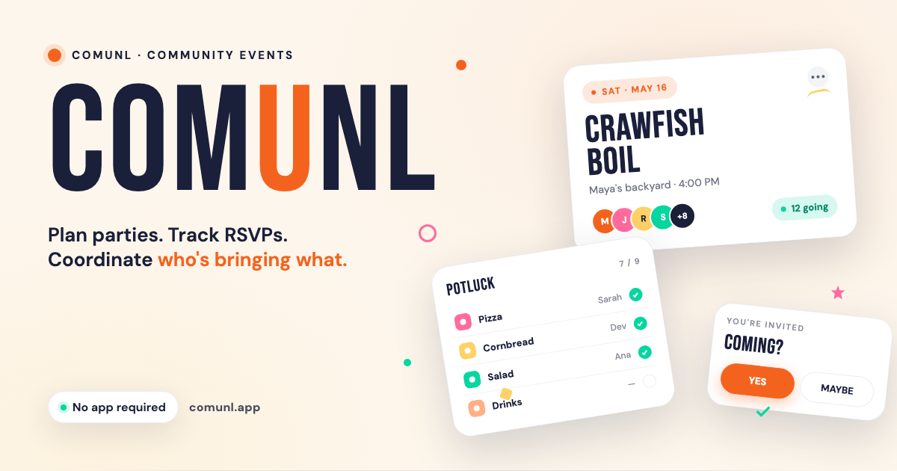
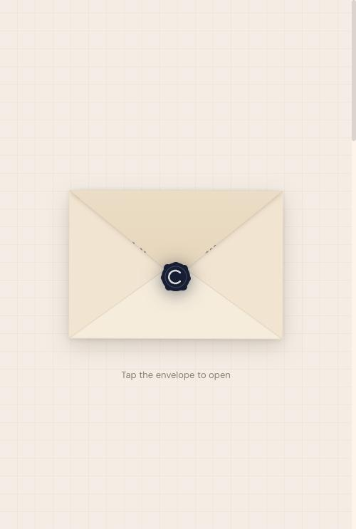
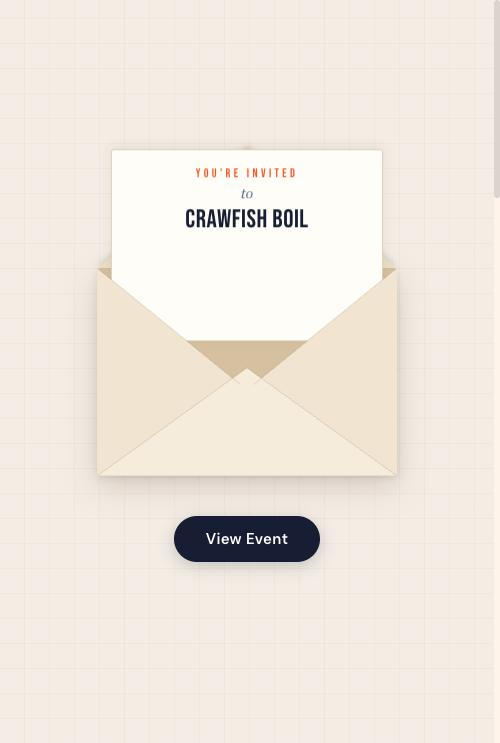
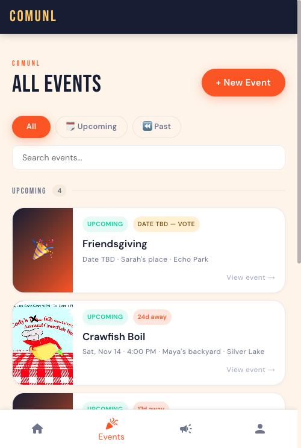
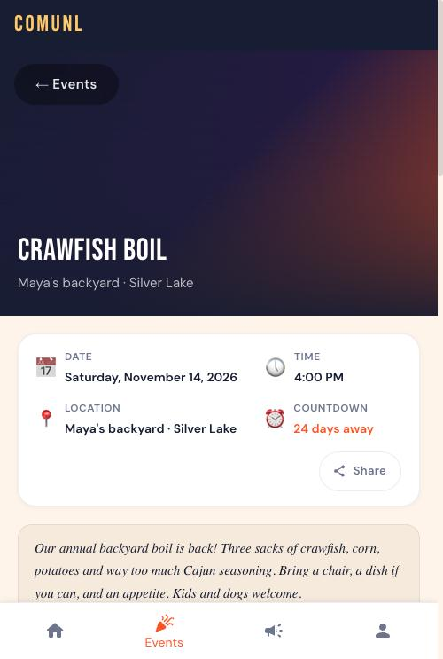
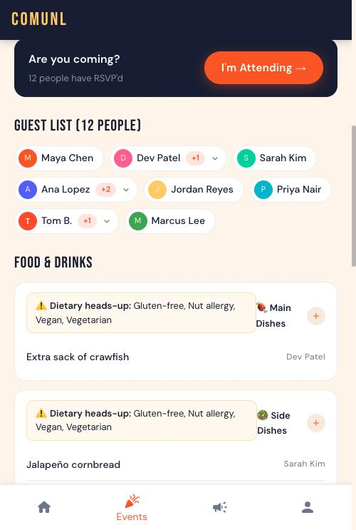
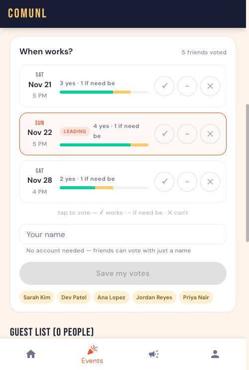
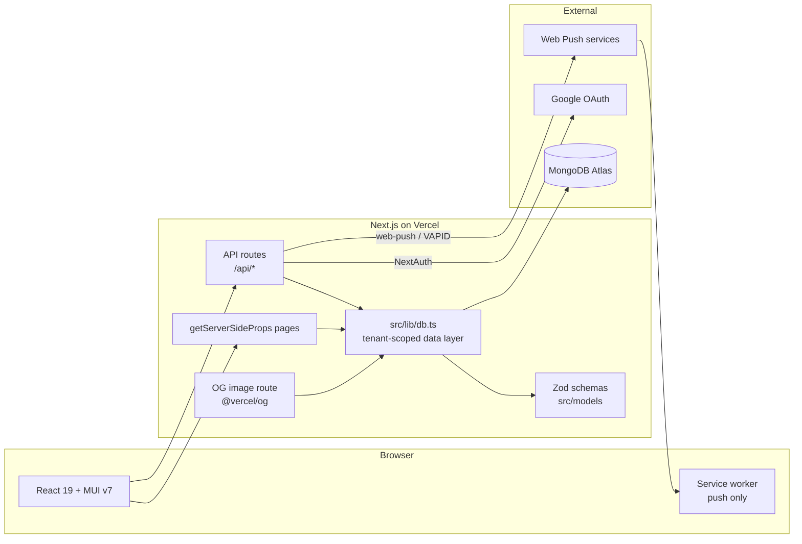
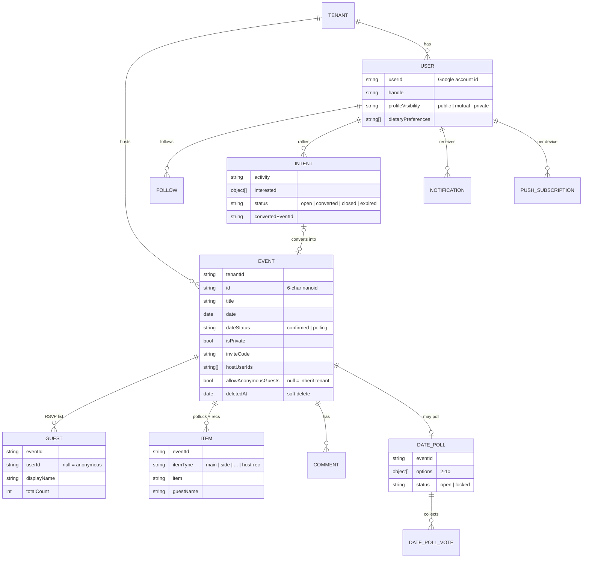

# Comunl

**Events for the people you actually know.**

Comunl (as in _communal_) is a multi-tenant event platform for friend groups and small communities.
Hosts plan parties, guests RSVP without needing an app, and everyone signs up for who's bringing
what. Beyond single events, Comunl gives a community continuity: a feed of things people want to do,
mutual-follow friendships, shared photo albums, and notifications when plans change.

It started as **Cody.party**, a single-host RSVP site. I rebuilt it as a multi-tenant platform where
Cody.party became the first branded tenant and Comunl became the public main site.

[](https://comunl.app)


[](https://comunl.app)

### 📱 Screenshots

<table>
  <tr>
    <td align="center"><br/><sub>A shared link opens as a sealed invite</sub></td>
    <td align="center"><br/><sub>…that unfolds into the event</sub></td>
    <td align="center"><br/><sub>Upcoming events</sub></td>
  </tr>
  <tr>
    <td align="center"><br/><sub>Event details and countdown</sub></td>
    <td align="center"><br/><sub>Guest list, potluck and dietary heads-ups</sub></td>
    <td align="center"><br/><sub>Date poll: no account needed to vote</sub></td>
  </tr>
</table>

<sub>Screenshots use sample data.</sub>

---

## ✨ What it does

|     | Feature                    | Details                                                                                                                        |
| --- | -------------------------- | ------------------------------------------------------------------------------------------------------------------------------ |
| 💌  | **Animated invitations**   | Shared links open with a wax-seal envelope animation: the seal cracks, the flap folds back in 3D and the letter slides out     |
| ✅  | **No-app RSVPs**           | Guests RSVP with just a name (plus +1s), or sign in with Google to keep their history; anonymous RSVPs are a per-event policy  |
| 🥘  | **Potluck sign-ups**       | Mains, sides, snacks, desserts, drinks and supplies, with attribution and host recommendations / wishlist                      |
| 🥜  | **Dietary heads-ups**      | Guests' dietary preferences show up as a heads-up in the potluck section, so people know what to bring                         |
| 🗳️  | **Date polls**             | Hosts propose up to 10 dates; guests vote yes / if-need-be / no, then the host locks one in and voters get notified            |
| 🙌  | **Rally**                  | A feed of things people _want_ to do ("anyone up for a hike?"); friends jump in and the author converts momentum into an event |
| 🤝  | **Friends & profiles**     | One-tap follow; a mutual follow makes you friends. Public profiles have public / mutual-only / private visibility              |
| 🔔  | **Notifications & push**   | In-app notifications plus Web Push to installed devices for interest, conversions, poll votes, locked dates and new followers  |
| 🔒  | **Private events**         | Unlisted events gated by an 8-character invite code, remembered per event in an httpOnly cookie                                |
| 📸  | **Comments & photo album** | Event comment threads, with attached photos collected into an album                                                            |
| 🖼️  | **Dynamic link previews**  | Per-event OpenGraph images rendered on the fly with `@vercel/og` and bundled fonts                                             |
| 📊  | **Admin analytics**        | Traffic chart and visitor map built on privacy-preserving page views: no IPs stored, ever                                      |
| 🎨  | **White-label tenants**    | Each community gets its own deploy with its own name, colors and guest policy, on a shared database                            |

---

## 🏗️ System architecture

Comunl is a Next.js **Pages Router** app deployed on Vercel. Pages render with `getServerSideProps`
and talk to MongoDB directly on the server; interactive features call API routes. All database
access goes through one module, `src/lib/db.ts`, which is where tenant scoping is enforced.



### Data flow

Every document read from MongoDB is parsed through a Zod schema before it leaves the data layer.
List reads are lenient (invalid docs are logged and skipped, so one bad record can't take down a
page); single reads throw. API routes never return raw Mongo docs: each model exports a
`Serialized*` type and a `serializeX()` helper that turns `ObjectId` and `Date` into strings, so the
wire format is explicit and JSON-safe.

Side effects are **best-effort by design**. Notifications are fanned out at write time and pushed to
every subscribed device, but a failed insert or push never fails the action that triggered it. Dead
push endpoints (404/410) are pruned as they're discovered. Analytics follows the same rule and can't
surface an error to a visitor.

### Project layout

```
pages/
├── api/
│   ├── [eventId]/          # per-event: details, RSVP, comments, items, poll, invite code
│   ├── events/             # list, create, featured
│   ├── intents/            # Rally posts and "I'm in" interest
│   ├── users/              # profiles, follows, RSVPs, search
│   ├── notifications/      # list + mark read
│   ├── push/               # Web Push subscription
│   ├── og/                 # dynamic OpenGraph images
│   ├── track.ts            # privacy-preserving page views
│   └── auth/               # NextAuth (Google)
├── events/                 # browse, create, event page, host admin
├── intents/                # Rally feed
├── profile/                # own profile + public profiles by handle
├── notifications/
└── admin/                  # analytics dashboard (admin-only)
src/
├── components/             # detail/, events/, intents/, layout/, admin/
├── lib/                    # db, auth, notify, push, nanoid, dietary
├── models/                 # Zod schemas, inferred types, serializers
└── styles/                 # MUI theme with validated per-tenant colors
scripts/                    # migrations, Atlas index definitions, world-map builder
public/                     # manifest, service worker, icons, bundled OG fonts
```

---

## 🗃️ Data model

Events sit at the centre. Guests (the RSVP list), items (potluck and host recommendations), comments
and date polls all hang off an event. The social layer (users, follows, Rally intents and
notifications) works across events. **Every collection carries a `tenantId`**, and the
`(tenantId, id)` unique index keeps event IDs unique per tenant.



> **IDs are designed for humans.** Event IDs are 6-character nanoids from a 57-character alphabet
> that drops look-alikes (`0/O`, `1/l/I`), so they survive being read aloud or typed from a flyer.

---

## 🧰 Tech stack

| Layer      | Choice                             | Why                                                                                                       |
| ---------- | ---------------------------------- | --------------------------------------------------------------------------------------------------------- |
| Framework  | Next.js 16 (Pages Router)          | SSR for shareable event pages and link previews, API routes in the same deploy                            |
| Language   | TypeScript                         | Shared types from server to client, all inferred from the Zod schemas                                     |
| UI         | React 19, MUI v7, Emotion          | Accessible components plus a theme that can be recolored per tenant at runtime                            |
| Database   | MongoDB Atlas (official driver)    | Event data is naturally document-shaped (polls, interested lists, +1s); no ODM layer to fight             |
| Validation | Zod v4                             | One schema validates request bodies, parses DB reads, and generates the TypeScript types                  |
| Auth       | NextAuth with Google               | One-tap sign-in for the people who want accounts, while guests can still RSVP anonymously                 |
| Push       | `web-push` + VAPID, service worker | Native-feeling notifications for the installed PWA with no app store                                      |
| Images     | `@vercel/og`                       | Per-event preview cards so links look good in iMessage, WhatsApp and Slack                                |
| Hosting    | Vercel                             | Zero-config deploys, one project per tenant, and edge geo headers for analytics without a geo-IP database |

---

## 🚀 Local development

**Prerequisites:** Node 20+, pnpm, a MongoDB Atlas cluster (the free tier is fine), and a Google
OAuth client.

```bash
pnpm install
```

Create `.env.local`:

```bash
# Required
MONGODB_URI=mongodb+srv://...
NEXTAUTH_URL=http://localhost:3000
NEXTAUTH_SECRET=...                # openssl rand -base64 32
GOOGLE_CLIENT_ID=...
GOOGLE_CLIENT_SECRET=...
ADMIN_EMAILS=you@example.com       # comma-separated

# Optional: Web Push (generate with `npx web-push generate-vapid-keys`)
NEXT_PUBLIC_VAPID_PUBLIC_KEY=...
VAPID_PRIVATE_KEY=...

# Optional: run as a branded tenant instead of the main site
NEXT_PUBLIC_TENANT_ID=codyparty
NEXT_PUBLIC_SITE_NAME=Cody.party
NEXT_PUBLIC_PRIMARY_COLOR=#F4631E
NEXT_PUBLIC_ACCENT_COLOR=#FFD166
NEXT_PUBLIC_ALLOW_ANONYMOUS_GUESTS=true
NEXT_PUBLIC_ALLOW_PUBLIC_EVENT_CREATION=false
```

Then:

```bash
pnpm dev          # dev server on http://localhost:3000
pnpm build        # production build
pnpm lint         # ESLint (import order + sorted JSX props enforced)
pnpm typecheck    # tsc --noEmit
pnpm test         # lint + Prettier check + typecheck
```

Database indexes are documented in `scripts/atlas-indexes.js`; paste them into mongosh or the Atlas
UI. One-off migrations live in `scripts/` and run with `npx tsx scripts/<name>.ts`.

---

## 🏘️ Multi-tenancy

Multi-tenancy is the central design constraint of the codebase.

- **One codebase, many deploys.** Each community is its own Vercel project. `NEXT_PUBLIC_TENANT_ID`
  selects the tenant; leave it unset and the deploy is the public Comunl main site.
- **One database, scoped everywhere.** Every collection has a `tenantId`, and every query in
  `src/lib/db.ts` filters on it. Keeping all Mongo I/O in one module makes that rule easy to audit.
- **Layered policy.** Settings such as anonymous RSVPs resolve from the most specific level down:
  the event's override, then the tenant's default in the `tenants` collection. A `null` on the event
  means "inherit".
- **Defensive theming.** Tenant colors come from env vars but are validated as hex before reaching
  MUI. A malformed value falls back to the defaults instead of crashing the theme at runtime.
- **Main-site features.** Rally, the follow graph and public profiles only exist on the main site. A
  shared guard keys them off the tenant identity rather than "is this an instance", so
  misconfiguring the main deploy can't accidentally switch them off.

---

## 🔐 Privacy & security

- **Analytics without tracking.** Page views store a SHA-256 hash of a server secret, the day, the
  IP and the user agent. That's enough to count unique visitors within a day, but it can't be
  reversed to an IP or linked across days. Location is the coarse city/region Vercel already
  resolves at the edge, and referrers are reduced to a hostname.
- **Private events stay private.** Private events, invite codes and member emails are filtered out
  of public listings and API responses (fixed in a dedicated security pass).
- **Sign-in never blocks.** The `signIn` callback upserts the user's profile on every login to keep
  it fresh, but a failed upsert doesn't lock anyone out.

---

## ⚖️ Trade-offs

**Pages Router over App Router.** The Pages Router's split between `getServerSideProps` and API
routes is simple and well understood, and it's what the project grew up on. Migrating to Server
Components would be a big effort for little user-facing benefit right now.

**One deploy per tenant instead of host-based routing.** Tenancy resolved from env vars means no
request-time lookup and complete isolation of branding and policy. The cost is a Vercel project per
community. That's fine for a handful of tenants, and I'd switch to domain-based resolution
(middleware reading the `Host` header against the `tenants` collection) at around a dozen.

**MongoDB driver + Zod instead of an ODM.** Zod gives runtime validation and static types from one
definition, and the raw driver keeps queries explicit, which matters when every one of them must be
tenant-scoped. The trade-off is hand-written serializers and no automatic population.

**Synchronous notification fan-out.** Notifications are written inline in the request that causes
them. Audiences are small (a rally's interested list, poll voters, hosts), so this beats running a
queue. It would need to move to a background job if audiences grew to hundreds.

**Photo links instead of uploads.** Comment photos are Imgur URLs, validated by pattern, rather than
uploads to storage. That avoids storage costs and moderation infrastructure, but it adds friction
for guests.

---

## 🔭 What I'd do differently

- **Automated tests from day one.** `pnpm test` currently means lint, format and typecheck. Jest and
  Testing Library are configured but not wired up. The tenant-scoping rule in `db.ts` especially
  deserves integration tests against a real MongoDB instance, and the RSVP and poll flows deserve
  end-to-end coverage.
- **CI on every push.** The same checks should run in GitHub Actions with a status badge, not only
  locally.
- **Signed invite tokens.** The private-event cookie stores the invite code itself. An HMAC-signed
  token would let codes rotate without exposing them.
- **Offline support.** The service worker handles push only. Caching the event pages someone has
  RSVP'd to would make the installed app useful with no signal.
- **Image uploads.** Direct uploads (for example to Cloudinary) for comments and event posters.

---

## 📄 License

© 2026. All rights reserved. This repository is public as a portfolio piece; please don't reuse the
code or branding without permission.

The admin visitor map's world outline comes from
[world-atlas](https://github.com/topojson/world-atlas) (Natural Earth data, public domain).
